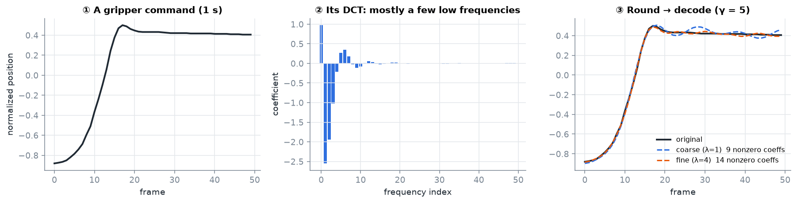
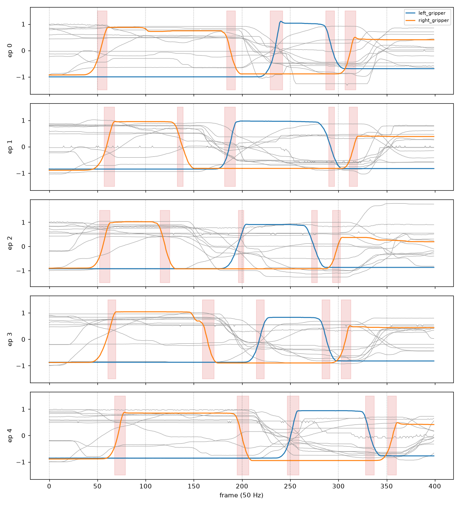
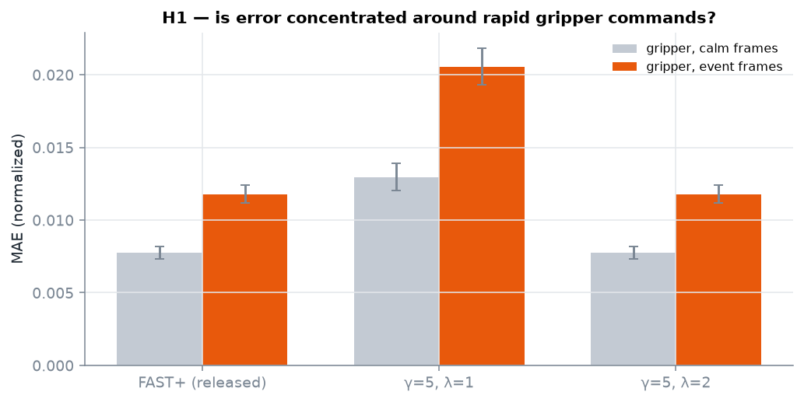
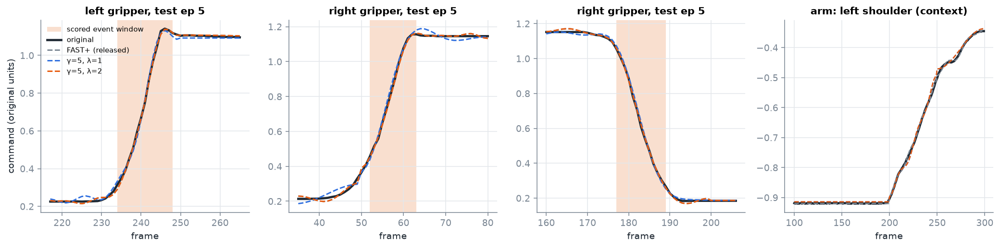
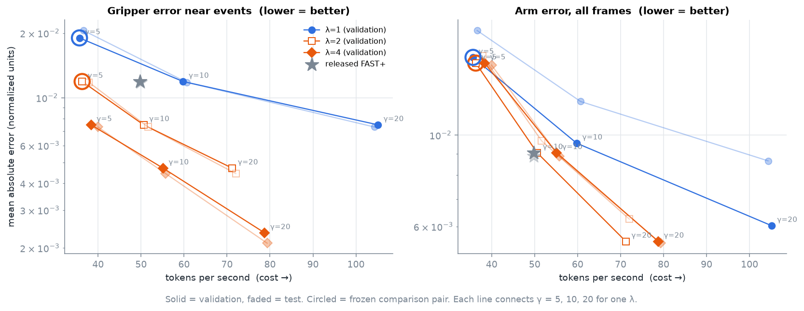

# Does compressing robot motion blur the moments that matter?

[](results/demo.mp4)

*55-second demo (click for the full MP4).*

## The question

Picture a robot handing a cube from one hand to the other. Most of that motion is slow and smooth: arms swinging into place. But a few moments are quick and important. A gripper snaps shut on the cube, or lets go of it.

Modern robot AI models learn from *compressed* versions of recorded motion, the same way language models read text as tokens instead of raw letters. Compression always loses a little detail. That's fine during a slow arm swing. But what if it loses the most detail in exactly the split second when the gripper closes?

So I asked two things:

1. **Does the compression lose more detail at those quick gripper moments?**
2. **If so, can we fix it cheaply by giving the gripper a bit more precision than the arm?**

## The answer

**Yes, and yes.** With FAST, the compression method Physical Intelligence uses in its robot models, errors are about 50% bigger around fast gripper moves than during the rest of the motion. Giving the gripper twice the precision cut those errors by **43%**, for only **3.5% more data**. It worked in every one of the 10 test demonstrations.


## How the compression works

FAST squeezes one second of robot motion (50 time steps × 14 motors) in three steps:

1. **Describe the motion as waves.** Each motor's movement is rewritten as a sum of smooth cosine waves (a *DCT*, the same trick JPEG uses for images). Smooth motion needs only a few waves.
2. **Round the numbers.** Each wave's strength is multiplied by a scale γ and rounded to a whole number. This is the only step that loses information. A bigger γ means finer rounding and more accuracy, but more to store.
3. **Pack into tokens.** The whole numbers are packed into tokens (*BPE*, the same method used for text). Nothing is lost in this step.



*Left: a real gripper closing. Middle: the waves that describe it. Right: after rounding, the coarse version (blue) wobbles. Giving the gripper finer rounding (orange) keeps it on track.*

**My one change:** before compressing, multiply the gripper signal by a factor λ. After decompressing, divide by λ again. That gives the gripper rounding steps that are λ times finer than the arm's, and nothing else changes. It's a simple trick; the work here is measuring whether it's worth the cost.

## The data

I used [`aloha_sim_transfer_cube_human`](https://huggingface.co/datasets/lerobot/aloha_sim_transfer_cube_human): 50 human-controlled demonstrations of a simulated two-armed robot passing a cube between its hands. Each one is 8 seconds long, recorded 50 times a second, with 14 motors (6 joints + 1 gripper per arm).



*Each row is one demonstration. The coloured lines are the two grippers; grey lines are the arm joints. Shaded bands are the "events": moments when a gripper moves fast. Every demonstration tells the same story: the right hand grabs the cube, the left hand takes it, the right hand lets go.*

I kept the experiment honest in a few ways:

- **Separate data for learning, choosing and testing.** The 50 demonstrations are split 30 / 10 / 10. Everything is fitted on the first 30. I picked the best settings on the next 10. The final 10 were only used once, for the results below.
- **A fair comparison.** I fitted my own FAST tokenizer, then compared it with and without the gripper weighting. The two versions are identical in every other way, so any difference comes from the weighting alone.
- **The rules came first.** The rule for choosing settings ("the token cost must be within 5%, and arm error can't get more than 5% worse") was written into the code before I looked at any results.
- **Episodes as the unit for statistics.** Frames from the same demonstration aren't independent, so the confidence intervals come from resampling whole demonstrations.

<details>
<summary>More detail on the setup</summary>

- **Normalization.** Each motor is scaled to roughly [−1, 1] using the 1st and 99th percentiles of the training data. Values outside that range are kept and counted (3.4% of test values), not cut off.
- **Events.** A gripper movement counts as an event when its frame-to-frame change is above the 90th percentile seen in training. Detections 3 or fewer frames apart are merged into one event, and each event is scored over ±3 frames (±60 ms). This gives about 5 events per demonstration.
- **Settings tried.** Rounding scale γ ∈ {5, 10, 20} and gripper weight λ ∈ {1, 2, 4}, all with a 2,048-token vocabulary (the same size as released FAST+). The planned 1,024 was too small for one of the settings, so I moved every setting to 2,048 rather than change it for one.
- **What got picked.** γ = 5 with λ = 2, compared against γ = 5 with λ = 1. The choice is frozen in [`configs/frozen.json`](configs/frozen.json).
- **Tests.** 11 tests in [`tests/`](tests/) check the split, chunking, event windows and reversibility, and that my implementation matches the official FAST exactly.

</details>

## Results

### 1. The errors do bunch up around fast gripper moves



With the released FAST+ tokenizer, gripper error is about **52% higher** during fast gripper moves than during calm stretches. That was true in all 10 test demonstrations. In absolute terms the errors are still small, about 0.6% of the motion's range.

### 2. Extra gripper precision fixes most of it, cheaply


Compared with the identical tokenizer without weighting:

| | Change | 95% confidence interval | Demos where it helped |
|---|---:|---:|---:|
| Gripper error at events | **−43%** | −35% to −51% | 10 / 10 |
| Worst-case (95th percentile) error | −43% | | 10 / 10 |
| Error in gripper speed | −20% | | 10 / 10 |
| Tokens per second (the cost) | **+3.5%** | | |
| Arm error | no change* | | |

\*Arm error is identical in 9 of the 10 demonstrations. The tenth has some unusually extreme values that happened to be handled slightly better, so the small arm "improvement" in the chart is luck, not a real gain.

Here's what that looks like on real data:



*The black line is the original motion. The blue line, without weighting, overshoots and wobbles around each gripper move. The orange line, with weighting, follows it closely.*

### 3. It holds across every setting I tried



*Each dot is one setting. Further left means cheaper, lower means more accurate. The weighted settings (orange) beat the unweighted ones (blue) at every budget.*

Two more checks:

- **Where you cut the motion into one-second pieces doesn't matter much.** I shifted the cut points five different ways, and the weighting helped every time, by 31% to 43%.

  

- **A second task.** On a different job, inserting a peg into a socket, the weighting helped just as much (−38%) once I refit on that task's data. Reusing the cube task's setup unchanged didn't work. The two tasks move the joints over different ranges, so a small tokenizer fitted to one task doesn't carry over to another.

  

<details>
<summary>Full results table (test set)</summary>

| Setting | Tokens/s | Gripper error at events | Arm error |
|---|---:|---:|---:|
| Released FAST+ (γ = 10) | 49.8 | 0.0118 | 0.0089 |
| γ = 5, λ = 1 (control) | 36.6 | 0.0206 | 0.0180 |
| **γ = 5, λ = 2 (weighted)** | **37.9** | **0.0118** | 0.0156 |
| γ = 5, λ = 4 | 40.0 | 0.0073 | 0.0148 |
| γ = 10, λ = 1 | 60.7 | 0.0118 | 0.0121 |
| γ = 10, λ = 2 | 51.6 | 0.0073 | 0.0097 |
| γ = 10, λ = 4 | 55.7 | 0.0044 | 0.0089 |
| γ = 20, λ = 1 | 104.3 | 0.0073 | 0.0087 |
| γ = 20, λ = 2 | 72.0 | 0.0044 | 0.0063 |
| γ = 20, λ = 4 | 79.3 | 0.0021 | 0.0055 |

Interesting details:

- Gripper error depends only on γ × λ. That's why the weighted setting exactly matches FAST+ on the gripper.
- Surprisingly, at γ = 10 and 20, adding gripper precision *reduced* the token count. I haven't worked out why yet.
- Against released FAST+, the weighted setting gives the same gripper accuracy for 24% fewer tokens, but with higher arm error. So it's a tradeoff, not a strict win.

</details>

## A bug I found along the way

My first run had a handful of errors around **900**, where normal errors are about 0.01. I traced them to FAST's official `fit()` function, which builds a new vocabulary from your own data.

FAST stores each number as a text character, and some characters are made of two bytes. If your training data never happens to produce one of those bytes, it's missing from the vocabulary. Then, when new data needs it, the byte is **silently dropped**, and the number decodes as garbage with no error raised. On my 160 held-out chunks, this corrupted up to 6 of them, depending on the setting. The released FAST+ tokenizer isn't affected, because it was trained on far more data.

The fix is one line: always include all 256 possible bytes in the vocabulary. It's in [`src/codecs.py`](src/codecs.py), with a test that reproduces the bug. To be transparent: I'd already seen the first (buggy) test results before fixing this. The fix didn't change which settings were chosen, and the old outputs are kept in [`results/first_run_bug/`](results/first_run_bug/).

## What this doesn't show

- **Whether robots actually perform better.** I only measured how well recorded motion survives compression; I didn't train a robot policy. That's the natural next experiment.
- **Real grasps.** An "event" here is a fast *commanded* gripper move, not a measured contact with the cube.
- **Broad generality.** These are two simulated tasks on one robot, with 10 test demonstrations each.
- **A new method.** Giving some channels more precision is a known engineering trick. What's new here is the careful measurement.

## Run it yourself

```bash
conda create -y -p ./.venv python=3.11
./.venv/bin/pip install -r requirements.txt
./.venv/bin/python -m scripts.run_all     # everything, about 20 seconds on a laptop
./.venv/bin/python -m pytest -q tests      # 11 tests
./.venv/bin/python -m scripts.make_demo   # rebuild the demo video (needs ffmpeg)
```

It needs no GPU and peaks at about 350 MB of memory. I checked it in a completely fresh environment, and it reproduced every number exactly. The dataset versions are pinned in [`configs/`](configs/), and all the raw results are in [`results/`](results/).

<details>
<summary>What's where</summary>

```
src/data.py        download, validate and split the data
src/preprocess.py  normalization and chunking
src/events.py      fast-gripper-move detector
src/codecs.py      FAST wrapper, weighting, and the bug fix
src/evaluate.py    metrics and confidence intervals
src/plots.py       all figures
scripts/run_all.py runs everything
scripts/transfer.py the second task
scripts/make_demo.py the demo video
```

</details>

## References

- Pertsch et al. *FAST: Efficient Action Tokenization for Vision-Language-Action Models.* 2025. [arXiv:2501.09747](https://arxiv.org/abs/2501.09747)
- Physical Intelligence. [FAST tokenizer](https://huggingface.co/physical-intelligence/fast)
- LeRobot datasets: [cube transfer](https://huggingface.co/datasets/lerobot/aloha_sim_transfer_cube_human) and [peg insertion](https://huggingface.co/datasets/lerobot/aloha_sim_insertion_human)
