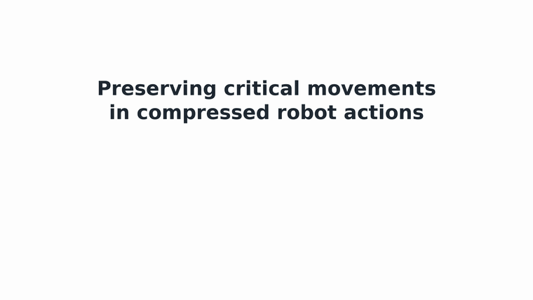
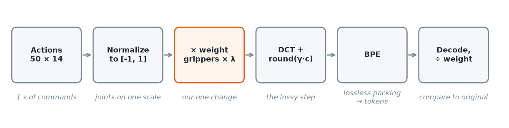
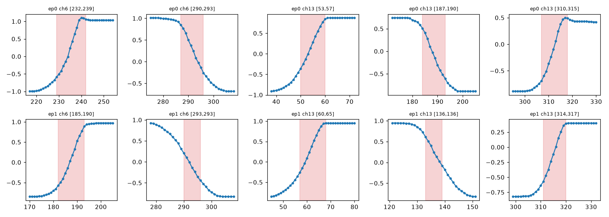
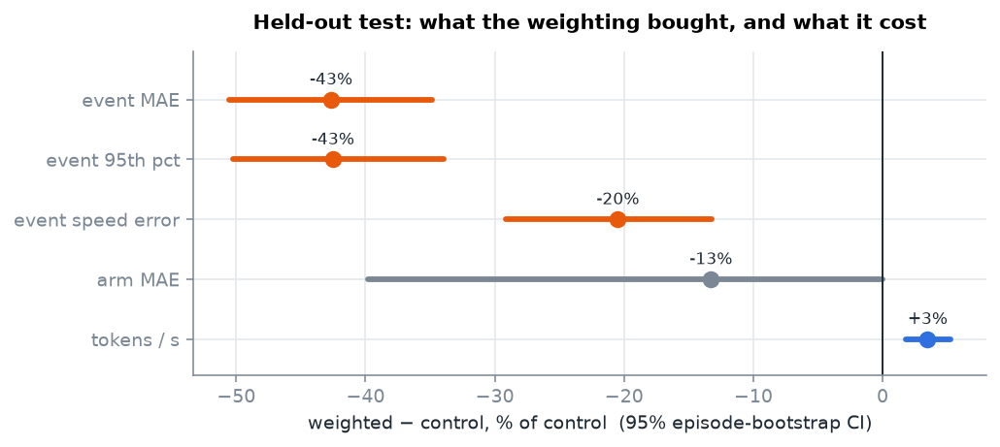
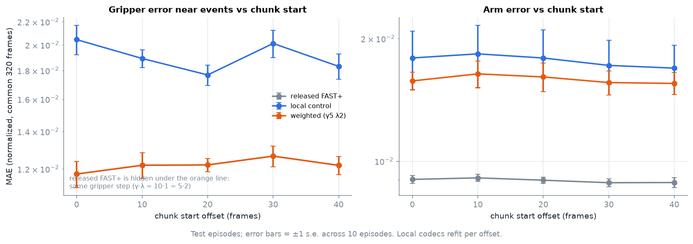
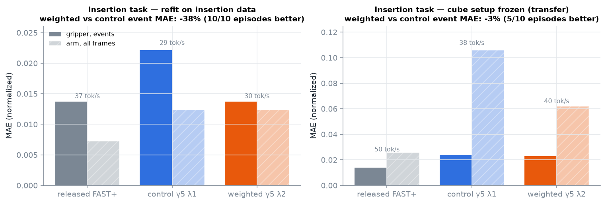

# Preserving critical movements in compressed robot actions

A small study of how the [FAST](https://arxiv.org/abs/2501.09747) action tokenizer handles fast gripper movements, and whether giving the gripper extra precision helps. Everything runs on a laptop CPU in about 20 seconds.

[](results/demo.mp4)

*55-second walkthrough (click for the full-quality MP4). Every frame is drawn from the real data and results; `python -m scripts.make_demo` regenerates it.*

## Short version

Robot learning models like π0-FAST turn motor commands into tokens, the same way a language model turns text into tokens. That compression loses a little detail. I wanted to know whether it loses *more* detail at the moments that seem to matter most, when a gripper opens or closes quickly, and whether a simple fix helps.

What I found, on 10 held-out demonstrations of a simulated ALOHA robot passing a cube between its hands:

- With the released FAST+ tokenizer, gripper error around fast open/close commands is about 52% higher than during the rest of the motion. That was true in all 10 test episodes.
- Doubling the gripper's quantization precision (relative to the arm) cut that error by 43% (95% CI 35–51%), and cost 3.5% more tokens. The comparison is against a tokenizer that is otherwise identical. It held at every chunk alignment I tried.
- This isn't a free improvement over FAST+ itself. My weighted tokenizer matches FAST+'s gripper accuracy with 24% fewer tokens, but its arm error is 75% higher. It sits at a different point on the same tradeoff.
- On a second task (peg insertion) the result held when I refit on that task (−38%). It did not hold when I reused the cube task's preprocessing unchanged.
- I also ran into a bug in the official `fit()` routine. Small fitted vocabularies can silently corrupt held-out data. It's described [below](#a-bug-in-small-vocabulary-fits).

All of this is offline reconstruction of recorded actions. I didn't train a policy, so none of it says whether a robot would actually grasp better.



## Background

A demonstration is a stream of numbers. Fifty times a second it gives target positions for the robot's 14 motors: six arm joints and one gripper on each of two arms. FAST compresses one second of this (a 50 × 14 *chunk*) in three steps:

1. **DCT.** Each channel's 50 values are rewritten as a sum of cosine waves. Smooth motion only needs a few low-frequency waves, which is the same reason JPEG works.
2. **Rounding.** Each wave's strength (its *coefficient*) is multiplied by a scale γ and rounded to an integer. This is the only lossy step. A larger γ gives finer steps, better accuracy, and more distinct values to store.
3. **BPE.** The integers are packed into tokens with byte-pair encoding, the same algorithm used for text. This step is lossless.


*Left: a real gripper close from the dataset. Middle: its DCT. Most of the energy is in the first ten or so frequencies. Right: after rounding at γ = 5, the coarse version (blue) wobbles after the motion. With four times the gripper precision (orange) it follows the original closely, but it keeps more non-zero coefficients.*

FAST+ is the general-purpose tokenizer Physical Intelligence released (γ = 10, 2,048-token vocabulary). The processor can also fit a new vocabulary on your own data.

### The change I tested

Multiply the two gripper channels by a weight λ before encoding, and divide by λ after decoding. The DCT is linear, so this is exactly the same as giving the gripper a rounding step λ times finer than the arm's:

$$\hat c_{k,j} = \frac{\mathrm{round}(\gamma\, w_j\, c_{k,j})}{\gamma\, w_j}, \qquad w_j = \lambda \text{ for grippers},\ 1 \text{ otherwise}$$

It doesn't look at future frames, and the decoder only needs to know λ. Per-channel quantization weights are a standard engineering trick, so the point here is to measure whether it's worth it, not to propose something new.

### Hypotheses

| | Hypothesis | Result |
|---|---|---|
| H1 | Error near fast gripper commands differs from error elsewhere | Supported: about 52% higher near events, in all 10 test episodes |
| H2 | Extra gripper precision lowers that error at a comparable token count | Supported against a matched local control (−43%, +3.5% tokens); not better than FAST+ overall |
| H2, second task | Same test on peg insertion | Holds when refit (−38%); doesn't transfer with the cube task's preprocessing |
| H3 | Where chunks start changes the error | Small effect (7% spread for FAST+, 14% for the local control); the weighting gain holds at every offset |

## Data

The main dataset is [`lerobot/aloha_sim_transfer_cube_human`](https://huggingface.co/datasets/lerobot/aloha_sim_transfer_cube_human), pinned at `6a43d50`. It contains 50 human-teleoperated demonstrations of a simulated two-arm ALOHA robot passing a cube from one hand to the other. Each episode is 400 frames at 50 Hz with 14 action channels. I checked the gripper channels by name: index 6 is `left_gripper` and index 13 is `right_gripper`. Only the action files are downloaded (about 2 MB, no video).

**Split.** The episodes are split 30 train / 10 validation / 10 test with a fixed seed. The split is by episode, not by chunk: neighbouring chunks from one demonstration are nearly identical, so splitting by chunk would leak between sets. Anything fitted (normalization, event thresholds, tokenizer vocabularies) uses training episodes only. Configurations are chosen on validation, and test is only used to report results. The IDs are in [`configs/split.json`](configs/split.json).

**Normalization.** Each channel is scaled to roughly [−1, 1] using its training 1st and 99th percentiles:

$$z_{t,j} = \frac{2\,(a_{t,j} - q_{.01,j})}{q_{.99,j} - q_{.01,j}} - 1$$

Values that land outside [−1, 1] are left as they are and counted: 1.7% of training, 2.9% of validation and 3.4% of test values. The largest is 2.55, in test episode 39.

**Chunks.** Chunks are one second (50 frames) long, don't overlap, and never cross episode boundaries. For the chunk-phase check I re-chunked with start offsets of 0, 10, 20, 30 and 40 frames. I only scored the 320 frames that every offset covers, so the comparison isn't distorted by edge effects.

**Gripper events.** An event here means a fast *commanded* gripper movement. It isn't a measured grasp or contact. The detector works like this:

1. On training data, look at the frame-to-frame change of each gripper.
2. Flag changes above the 90th percentile of non-zero changes.
3. Merge flags that are 3 or fewer frames apart into one event.
4. Score each event over ±3 frames (±60 ms).

The thresholds were frozen before I looked at validation data. The detector finds about 5 events per episode (147 train / 48 validation / 48 test), covering around 13% of frames, and every episode has at least one.


*Five training episodes. The two coloured lines are the grippers; grey lines are the arm joints. Shaded bands are the scored event windows and dotted lines mark the one-second chunk boundaries. The right gripper grabs the cube, the left one takes it, then the right one lets go.*

<details>
<summary>Ten individual events I checked before freezing the detector</summary>


</details>

## Method

I compared three kinds of tokenizer:

| Method | What it is |
|---|---|
| Released FAST+ | The official processor, unchanged (revision `ec4d7aa`) |
| Local control (λ = 1) | FAST fitted on my 240 training chunks |
| Weighted local (λ > 1) | Same as the control, but with the gripper weighting |

Beating FAST+ alone wouldn't show that the weighting works, because fitting locally is a second change. So the main comparison is weighted against the local control, with everything else held the same.

**Search.** I tried γ ∈ {5, 10, 20} and λ ∈ {1, 2, 4}, which gives nine local configurations. I'd planned a 1,024-token vocabulary, but the official fit rejected γ = 20, λ = 4 at that size because its coefficients span 1,161 values. Rather than enlarge the vocabulary for that one configuration only, I moved all of them to 2,048, the same size FAST+ uses.

**Selection rule.** I wrote this into the code before looking at any validation numbers:

1. Pair each weighted config with each control whose token rate is within 5%.
2. Discard pairs where arm error gets more than 5% worse.
3. Pick the pair with the biggest drop in event error.

On validation, the rule picked γ = 5, λ = 2 against γ = 5, λ = 1: token rates within 1.8% of each other, 37% lower event error, no arm cost. That choice is frozen in [`configs/frozen.json`](configs/frozen.json).

**Metrics.** The main metric is event MAE: the mean absolute gripper error over the event frames, in normalized units. Alongside it I report:

- the 95th-percentile event error
- error in the frame-to-frame change near events (whether the gripper moves at the right speed)
- arm MAE over all frames
- tokens per second
- encode and decode time

**Statistics.** Frames from the same episode aren't independent, so I treat each episode as one data point. Every comparison is a per-episode paired difference. The 95% intervals come from resampling the 10 test episodes 2,000 times. With 10 episodes the intervals are fairly wide.

**Tests.** The [`tests/`](tests/) folder has 11 tests. They check that:

- the split is disjoint and deterministic
- chunks never cross episode boundaries
- event windows behave as specified
- the weighting is exactly reversible
- my own DCT-and-round implementation matches the official FAST+ round trip exactly
- the weighted path through the official encoder matches the formula above
- decode failures come back as NaN instead of the official decoder's silent zeros
- the byte-coverage bug described below stays fixed

## Results

All numbers are on the held-out test set unless I say otherwise. Per-episode tables are in [`results/`](results/).

### Rate vs. error


*Each line is one λ, going from γ = 5 (cheap, left) to γ = 20 (expensive, right). Lower and further left is better. Circles mark the frozen pair. Solid points are validation; faded points are test.*

| Method | Tokens/s | Event MAE | Event p95 | Arm MAE |
|---|---:|---:|---:|---:|
| Released FAST+ (γ = 10) | 49.8 | 0.0118 | 0.0358 | 0.0089 |
| Local control, γ = 5, λ = 1 | 36.6 | 0.0206 | 0.0624 | 0.0180\* |
| Weighted, γ = 5, λ = 2 | 37.9 | 0.0118 | 0.0358 | 0.0156\* |
| γ = 5, λ = 4 | 40.0 | 0.0073 | 0.0237 | 0.0148\* |
| γ = 10, λ = 1 | 60.7 | 0.0118 | 0.0358 | 0.0121\* |
| γ = 10, λ = 2 | 51.6 | 0.0073 | 0.0237 | 0.0097 |
| γ = 10, λ = 4 | 55.7 | 0.0044 | 0.0143 | 0.0089 |
| γ = 20, λ = 1 | 104.3 | 0.0073 | 0.0237 | 0.0087 |
| γ = 20, λ = 2 | 72.0 | 0.0044 | 0.0143 | 0.0063 |
| γ = 20, λ = 4 | 79.3 | 0.0021 | 0.0065 | 0.0055 |

\* Inflated by clipping in one or two episodes with extreme values (see the note on arm error below).

A few observations:

- **Gripper error depends only on γ × λ.** Configurations with the same product have exactly the same event error. γ5·λ2, γ10·λ1 and FAST+ (γ = 10) all score 0.0118. That makes sense: the weighting just sets the gripper's rounding step independently of the arm's.
- **Weighting wins on the gripper.** At every token budget, the weighted lines sit well below the unweighted one.
- **One result I didn't expect.** At γ = 10 and γ = 20, adding gripper precision *lowered* the token count. For example, γ = 20 used 104 tokens/s unweighted but 72 with λ = 2. My guess is that the fixed 2,048-entry BPE vocabulary gets spent differently when the range of coefficient values changes, but I haven't checked. Either way, token cost depends on the fitted vocabulary and not just on precision.

### The frozen comparison



| Weighted (γ5 λ2) minus control (γ5 λ1) | Change | 95% CI | Episodes better |
|---|---:|---:|---:|
| Event MAE | −43% (−0.0088) | −0.0104 to −0.0072 | 10 / 10 |
| Event 95th percentile | −43% | −0.0313 to −0.0212 | 10 / 10 |
| Event speed error | −20% | −0.0039 to −0.0018 | 10 / 10 |
| Tokens per second | +3.5% (+1.3) | +0.7 to +1.9 | n/a |
| Arm MAE | −13% | −0.0072 to 0.0000 | 1 / 10 |

The token rates are within 5% of each other, so by the rule I set in advance this counts as a matched-budget improvement. The validation estimate was −37% and the test result was −43%.

**A note on arm error.** The weighting doesn't change how the arm is quantized, and arm error is identical in 9 of the 10 test episodes. The exception is episode 39, which has values far enough outside the training range that some coefficients get clipped. The weighted version clips fewer of them, more or less by chance. So the arm result means "no arm cost", not "the arm got better".

### Is the error concentrated around events? (H1)


For FAST+, gripper error is 0.0118 inside event windows and 0.0078 elsewhere: 52% higher (paired difference 0.0040, CI 0.0034–0.0047), and higher in every test episode. The local control shows the same pattern (+59%). The errors are small in absolute terms, though. 0.012 on a [−1, 1] scale is about 0.6% of the range.

### What it looks like


*Test episode 5, in original units. The coarse control (blue) undershoots and wobbles around gripper moves. The weighted version (orange) lies exactly on top of FAST+, because both use the same gripper step. The arm (right panel) is reproduced closely by all three.*

### Chunk alignment (H3)



For each start offset I refit the local tokenizers on training chunks with that same offset, then scored the same 320 frames.

| | Spread in event MAE across offsets | Best / worst offset |
|---|---:|---:|
| Released FAST+ | 0.0009 (7% of the mean) | 0 / 30 |
| Local control | 0.0028 (14%) | 20 / 0 |
| Weighted | same as FAST+ | 0 / 30 |

The weighted version beats the control at every offset: −43%, −36%, −31%, −37% and −33% for offsets 0 through 40. Each CI excludes zero, and each offset favours weighting in all 10 episodes. The headline uses offset 0, which was decided in advance.

### Speed and resources

| | Encode (ms/chunk) | Decode (ms/chunk) |
|---|---:|---:|
| Released FAST+ | 0.38 | 0.10 |
| Local control / weighted | 0.25 | 0.07 |

These timings are from an M-series MacBook (10 cores), using batches of 32 after a warm-up. The weighting adds no measurable overhead. The whole pipeline, covering both datasets, every configuration, the bootstrap, the phase audit and the figures, takes about 20 seconds and peaks at about 350 MB of memory. Each run logs this to [`results/run_manifest.json`](results/run_manifest.json).

The final run had no decode failures and no corrupted decodes. The local tokenizers clipped a handful of coefficients: 9 of 257,600 for the control and 6 for the weighted version, all in outlier episodes. FAST+ clipped none.

### Second task: peg insertion

[`lerobot/aloha_sim_insertion_human`](https://huggingface.co/datasets/lerobot/aloha_sim_insertion_human) (pinned at `cc571a3`) uses the same robot for a different job: one hand holds a socket while the other inserts a peg. It has the same 14 channels and 50 episodes, with 500 frames each. I gave it its own 30/10/10 split and reused the frozen γ5 λ2 vs γ5 λ1 choice without re-selecting anything. Then I evaluated it two ways:



| Insertion test (10 episodes) | Event MAE change | Episodes better | Tokens |
|---|---:|---:|---:|
| Refit on insertion training data | −38% (CI −0.0106 to −0.0059) | 10 / 10 | +2.9% |
| Cube-task preprocessing and tokenizers, unchanged | −3% (CI includes 0) | 5 / 10 | +2.9% |

When I refit on insertion data, the result matches the cube task: a large gripper improvement, the same arm error, and a small token cost.

When I reused the cube task's setup unchanged, the improvement disappeared. The reason is the normalization, not the weighting. Insertion uses different joint ranges, so the cube normalization puts 45% of its values outside [−1, 1], some as far out as 13.9. Those values push coefficients below what the vocabulary can represent, and 155 of them get clipped. Arm error goes up tenfold, and the gripper difference gets lost in it. FAST+ copes much better, because it was fitted on varied data.

So a small, locally fitted tokenizer is specific to its task. It needs refitting, or more robust normalization, before you use it on different motion.

## A bug in small-vocabulary fits

My first full run had a few reconstruction errors around 900, where normal errors are around 0.01. I traced it to the official `UniversalActionProcessor.fit()`:

1. FAST turns each integer coefficient into one Unicode character and hands the string to a byte-level BPE tokenizer.
2. Characters with codes of 128 or more become two UTF-8 bytes. The BPE vocabulary only contains bytes that appeared in the training data.
3. Suppose a held-out chunk produces a coefficient just outside the training range (symbol 147 when training only went up to 145). One of its bytes isn't in the vocabulary, and the tokenizer drops it without any warning.
4. On decode, the leftover half-character becomes `U+FFFD` (code 65,533). That turns into a garbage coefficient, and no exception is raised.

Here is how often the unmodified official fit corrupts or fails on my 160 held-out chunks:

| Config | Byte symbols missing | Chunks corrupted or failed |
|---|---:|---:|
| γ = 5, λ = 1 | 146 / 256 | 1 |
| γ = 5, λ = 2 | 113 / 256 | 6 |
| γ = 10, λ = 1 | 43 / 256 | 4 |
| all others | 0 | 0 |

FAST+ itself isn't affected: it was fitted on a lot of data and contains all 256 byte symbols. The bug only shows up when you fit your own small vocabulary, which the model card suggests doing.

**The fix** is in [`src/codecs.py`](src/codecs.py). It's a copy of the official fit with one change: the BPE initial alphabet is always the full 256-symbol byte-level alphabet. Both the control and the weighted version use it. I also treat any decode that doesn't reproduce the encoded coefficients exactly as a failure (NaN), never as valid motion. A regression test reproduces the bug with the official routine and checks the fix.

I should be upfront about one thing. My first test run used the buggy fit, and I saw those test numbers before fixing it. The fix didn't change any design decision, and the selection rule picked the same pair before and after. The first run's outputs are kept in [`results/first_run_bug/`](results/first_run_bug/).

## Limitations

- **No policies.** This only measures how well recorded actions survive compression. It doesn't tell you whether a model trained on these tokens grasps better, whether *generated* tokens behave similarly, or anything about closed-loop success. That's the obvious next experiment: train a small policy on control tokens and on weighted tokens, and compare gripper timing.
- **Not better than FAST+ overall.** Against FAST+, the weighting trades arm accuracy for tokens. For example, γ10·λ2 has 38% lower gripper event error than FAST+ for about 4% more tokens, but about 9% higher arm error.
- **No contact information.** Events are fast commanded gripper moves, not measured grasps.
- **Small scope.** There are two simulated, teleoperated tasks on one robot, with 10 test episodes each, and the effect needed a task-specific fit.
- **Not a new method.** Per-channel quantization weights are a known idea. What I've contributed is the controlled measurement.

## Reproducing

```bash
conda create -y -p ./.venv python=3.11        # no PyTorch needed
./.venv/bin/pip install -r requirements.txt
./.venv/bin/python -m scripts.run_all          # everything, ~20 s after the first download
./.venv/bin/python -m pytest -q tests
./.venv/bin/python -m scripts.make_demo        # optional, needs ffmpeg
```

`run_all` reuses `configs/split.json` and `configs/frozen.json` if they exist, so nothing gets re-selected on test data. Delete `frozen.json` to redo the selection from scratch. Package versions are in [`configs/versions.json`](configs/versions.json).

I checked this from scratch: I copied only the code and pinned configs into a clean folder with a new environment, no data, no Hugging Face cache and no `frozen.json`. That run made the same selection and reproduced every number in every results table exactly. It also caught a bug. `run_all` used to skip the download whenever the config files existed, so a fresh clone had no data. That's fixed now.

## Repository layout

```
src/
  data.py        download at a pinned revision, schema checks, split, loading
  preprocess.py  normalization, chunking, common-frame mask
  events.py      gripper event detector
  codecs.py      reference DCT quantizer, FAST+ wrapper, fixed local fit, weighting
  evaluate.py    per-episode metrics, paired bootstrap, timing
  plots.py       the figures in this README
scripts/
  run_all.py     runs everything
  prep_report.py normalization and event stats, data figures
  transfer.py    second task (insertion)
  make_demo.py   renders the demo video
  sanity_fast.py synthetic round-trip check
  save_versions.py
configs/         pinned revisions, splits, normalization, event thresholds, frozen choice
results/         CSV/JSON results, figures, demo video, run manifest, first_run_bug/
tests/           11 tests
```

## Decisions made along the way

| Decision | Reason |
|---|---|
| Merge event detections 3 or fewer frames apart (decided on training data) | A single open or close was sometimes split in two. This brought training events from 235 down to 147, about one per visible transition, without changing which frames are scored. |
| 2,048-token vocabulary for every local config | The official fit rejected γ20·λ4 at 1,024, and changing the budget for one config only wouldn't be fair. |
| Full-alphabet BPE fit; corrupted decodes count as failures | The byte-coverage bug above. Selection didn't change. |
| Second task: reuse the frozen choice, report transfer and refit separately | Reusing the cube task's setup is what tests transfer; anything refit has to be labelled as such. |
| `run_all` always runs the download step | A fresh clone has configs but no data. |

## References

1. Pertsch et al. *FAST: Efficient Action Tokenization for Vision-Language-Action Models.* 2025. [arXiv:2501.09747](https://arxiv.org/abs/2501.09747)
2. Physical Intelligence. [FAST processor and model card](https://huggingface.co/physical-intelligence/fast).
3. LeRobot. [`aloha_sim_transfer_cube_human`](https://huggingface.co/datasets/lerobot/aloha_sim_transfer_cube_human) and [`aloha_sim_insertion_human`](https://huggingface.co/datasets/lerobot/aloha_sim_insertion_human).
